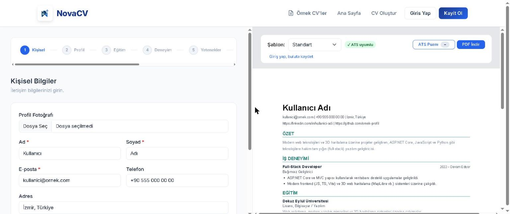

# NovaCV: ATS Uyumlu CV Oluşturucu

İşe alım sistemlerinin (ATS) ve yapay zeka puanlayıcılarının sorunsuz okuyabildiği CV'ler hazırlamaya yardım eden web uygulaması. Kullanıcı bilgilerini adım adım girer, CV'sini canlı önizlemede görür, ATS puanını ve iyileştirme önerilerini takip eder, sonra metin tabanlı PDF olarak indirir.



## Özellikler

- **Adım adım form:** kişisel bilgiler, özet, eğitim, deneyim, yetenekler, diller, sertifikalar, projeler ve özel bölümler
- **Canlı önizleme:** her değişiklik anında CV'ye yansır
- **7 ATS uyumlu şablon:** Standart, Klasik, Modern, Kurumsal, Zarif, Teknik, Kompakt. Hepsi tek sütunlu ve standart başlıklı
- **ATS puanı (0–100):** iletişim bilgileri, ölçülebilir sonuçlar, etken fiiller, yetenek sayısı, CV uzunluğu gibi ölçütlere göre puanlar; her adımda ne eksik olduğunu söyler
- **İş ilanı eşleştirme:** ilan metni yapıştırılınca CV'de eksik olan anahtar kelimeleri gösterir
- **Metin tabanlı PDF:** PDF resim değil gerçek metindir, ATS okuyabilir. Sayfayı az farkla aşan CV otomatik olarak tek sayfaya sığdırılır
- **Kayıt:** veriler tarayıcıda otomatik saklanır; giriş yapan kullanıcı CV'sini sunucuya kaydedebilir

## Teknolojiler

- ASP.NET Core MVC (.NET 10), C#
- Entity Framework Core, SQLite, ASP.NET Core Identity
- JavaScript, HTML, CSS
- Quill (zengin metin), SortableJS (sürükle-bırak sıralama), DOMPurify (XSS koruması)

## Çalıştırma

[.NET 10 SDK](https://dotnet.microsoft.com/download) gerekir.

```bash
dotnet run --project cvoluşturma --launch-profile http
```

Ardından tarayıcıda `http://localhost:5213` adresini aç. Veritabanı ilk çalıştırmada otomatik oluşturulur.
